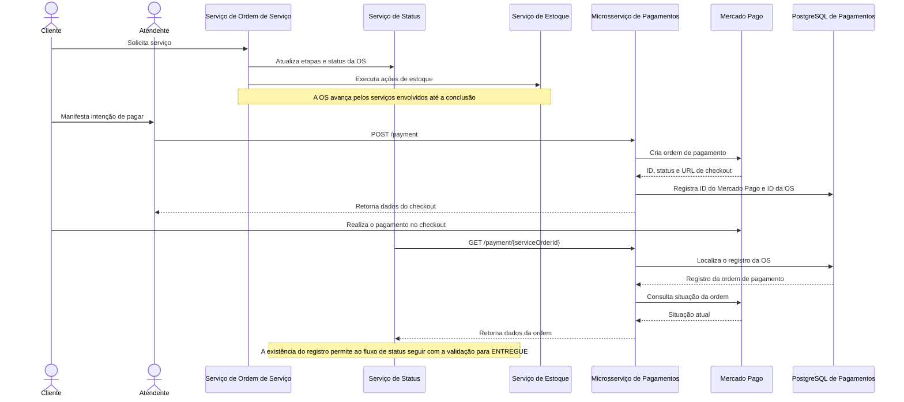

# Microsserviço de Pagamentos

Este repositório contém um dos três novos microsserviços da arquitetura do projeto. Sua responsabilidade é receber solicitações de pagamento, criar a ordem de pagamento na API do Mercado Pago e manter, em seu próprio PostgreSQL, o vínculo entre a ordem de serviço e a ordem criada no provedor.

O serviço participa de um fluxo de negócio maior, mas não é iniciado automaticamente pela criação da ordem de serviço. Ele é acionado quando a ordem de serviço foi concluída e o cliente deseja pagar; nessa etapa, o atendente solicita a criação do pagamento. O serviço de status consulta este microsserviço para confirmar que há um registro associado à ordem antes de liberar o status **ENTREGUE**.

O serviço é executado junto aos demais componentes da solução em infraestrutura própria. O projeto inclui configuração de contêineres para desenvolvimento e recursos Terraform para implantação em Kubernetes.

## Fluxo de negócio



O microsserviço persiste o registro após obter a ordem criada pelo Mercado Pago. A situação apresentada na consulta é obtida do Mercado Pago; a existência do registro local, por sua vez, permite aos demais serviços identificar que há um processo de pagamento associado à ordem de serviço.

## Microsserviços e Saga Pattern

### Técnicas e características de microsserviços presentes

- **Responsabilidade delimitada:** o serviço concentra a criação e a consulta de pagamentos, sem assumir as responsabilidades de ordem de serviço, estoque ou atualização de status.
- **Persistência por serviço:** os dados de pagamento são gravados em uma base PostgreSQL própria, por meio do TypeORM e de uma migração versionada.
- **Integração por API:** o serviço encapsula a comunicação com o Mercado Pago em um cliente dedicado e expõe endpoints HTTP para o atendente e para os serviços consumidores.
- **Baixo acoplamento de domínio:** os demais componentes podem consultar o pagamento por `serviceOrderId`, sem acessar diretamente a base de dados deste serviço.
- **Validação de entrada:** DTOs e `class-validator` validam os dados recebidos, incluindo e-mail, tipo de documento, campos aninhados e formato numérico da ordem e do valor.
- **Autenticação entre chamadas:** as rotas passam pelo guard JWT global; a rota de saúde é explicitamente pública.
- **Execução conteinerizada:** há Docker Compose para subir aplicação e PostgreSQL, além de configuração Terraform para Deployment e Service Kubernetes.

### Conceitos de Saga no fluxo

Uma Saga representa uma transação de negócio de longa duração composta por etapas locais executadas por serviços independentes. Neste projeto, o fluxo aplica esses conceitos da seguinte maneira:

1. **Etapas de negócio independentes:** a criação da OS e suas ações de status e estoque ocorrem antes da etapa de pagamento, em serviços com responsabilidades próprias.
2. **Participação local na Saga:** o microsserviço de pagamentos executa sua etapa quando há intenção de pagamento, integrando-se ao Mercado Pago e persistindo o vínculo localmente.
3. **Transação local e persistência isolada:** o registro do pagamento é realizado na base deste serviço; o serviço de status consulta a API de pagamentos, em vez de consultar diretamente o PostgreSQL.
4. **Progressão condicionada:** o registro associado à OS funciona como condição para o serviço de status prosseguir com a liberação de **ENTREGUE**, conforme o fluxo do sistema.
5. **Serviços autônomos:** cada etapa pode ser desenvolvida e implantada dentro de seu próprio limite de responsabilidade, enquanto o processo de negócio atravessa os serviços.

Este repositório implementa a etapa de pagamentos e os pontos de integração descritos acima. A coordenação das demais etapas da OS pertence aos serviços correspondentes; este serviço não atua como orquestrador global da Saga.

## Arquitetura interna por módulos

O projeto usa NestJS e organiza os componentes por responsabilidade:

| Módulo/componente | Responsabilidade |
| --- | --- |
| `AppModule` | Composição da aplicação, configuração global, conexão TypeORM, autenticação e registro dos módulos. |
| `PaymentModule` | Agrupa controller, serviço de domínio, entidade, repositório TypeORM e cliente HTTP do Mercado Pago. |
| `PaymentController` | Expõe criação de pagamento, consulta por ordem de serviço e recebimento do webhook. |
| `PaymentService` | Conduz o caso de uso: prepara os dados da ordem, aciona o Mercado Pago, persiste a associação e consulta a situação. |
| `MercadoPagoClient` | Encapsula chamadas à API de Orders e obtenção/cache do token de acesso. |
| `Payment` | Entidade TypeORM que representa a relação entre a ordem de serviço e a ordem externa de pagamento. |
| `AuthModule` / `AuthGuard` | Valida tokens JWT nas rotas protegidas. |
| `HealthController` | Fornece o endpoint público de saúde usado, entre outros fins, pela verificação de disponibilidade. |
| `FallbackModule` | Retorna `404 Not Found` para rotas não mapeadas. |
| `common/HttpClient` | Fornece a base de chamadas HTTP autenticadas e reutilizável para integrações externas. |
| `configs` e `migrations` | Configuram a conexão com PostgreSQL e versionam a criação do esquema. |

### Persistência

A tabela `tb_payment` mantém:

| Campo | Uso |
| --- | --- |
| `orderId` | ID da ordem criada no Mercado Pago; chave primária local. |
| `service_order_id` | ID da ordem de serviço; possui restrição de unicidade para associar no máximo um registro a cada OS. |

O esquema é criado pela migração `1794867026101-payment`. A configuração TypeORM executa migrações na inicialização e mantém `synchronize` desabilitado.

### Integração com o Mercado Pago

Na criação de uma ordem, o serviço envia valor, descrição, dados do pagador e do veículo, referência externa `so-{serviceOrderId}`, URLs de retorno do frontend e prazo de expiração de um dia. O Mercado Pago retorna, entre outros dados, o identificador, o status inicial e a URL de checkout. A chave de idempotência da chamada é gerada para cada solicitação.

O cliente usa `MP_ACCESS_TOKEN` quando fornecido. Caso contrário, obtém um token OAuth do Mercado Pago com `CLIENT_ID` e `CLIENT_SECRET`, mantendo o token em cache até próximo do vencimento. A consulta de status busca a ordem no Mercado Pago usando o ID previamente persistido.

O endpoint de webhook reconhece notificações do tipo `order`, consulta a ordem no Mercado Pago e registra informações de acompanhamento nos logs. A resposta confirma o recebimento (`{ "received": true }`).

## API HTTP

A aplicação escuta a porta `3004` por padrão. A documentação Swagger é disponibilizada em `/api`.

| Método | Rota | Acesso | Descrição |
| --- | --- | --- | --- |
| `POST` | `/payment` | JWT | Cria a ordem no Mercado Pago, persiste a associação com a OS e retorna os dados de checkout. |
| `GET` | `/payment/:serviceOrderId` | JWT | Localiza a associação local e retorna a situação atual consultada no Mercado Pago. Retorna `404` quando não há registro para a OS. |
| `POST` | `/payment/webhook` | JWT | Recebe o webhook e consulta a ordem notificada. |
| `GET` | `/health` | Público | Retorna a situação de disponibilidade do serviço. |

As rotas protegidas esperam `Authorization: Bearer <token>`.

### Exemplo de criação

```json
{
  "serviceOrderId": 123,
  "cost": 250.5,
  "payer": {
    "name": "Nome do Cliente",
    "email": "cliente@example.com",
    "document": "12345678900",
    "documentType": "CPF"
  },
  "vehicle": {
    "model": "Modelo do Veículo",
    "plate": "ABC1D23"
  },
  "description": "Serviço automotivo"
}
```

`description` é opcional. `documentType` aceita `CPF` ou `CNPJ`.

### Exemplo de resposta

```json
{
  "checkoutUrl": "https://www.mercadopago.com/checkout/...",
  "orderId": "ID-DA-ORDEM-NO-MERCADO-PAGO",
  "serviceOrderId": 123,
  "status": "ACTION_REQUIRED",
  "totalAmount": "250.50"
}
```

O conteúdo de `status` é fornecido pelo Mercado Pago. A resposta de consulta (`GET`) também é o objeto da ordem retornado pela API do Mercado Pago.

## Configuração e execução

### Variáveis de ambiente

Configure os valores no ambiente de execução ou em um arquivo `.env` local. Não versione credenciais.

| Variável | Finalidade |
| --- | --- |
| `PORT` | Porta HTTP; padrão `3004`. |
| `DB_HOST` | Host do PostgreSQL. |
| `DB_PORT` | Porta do PostgreSQL; padrão `5432`. |
| `DB_NAME` | Nome da base de dados. |
| `DB_USER` | Usuário do PostgreSQL. |
| `DB_PASSWORD` | Senha do PostgreSQL. |
| `MP_ACCESS_TOKEN` | Token de acesso do Mercado Pago, quando configurado diretamente. |
| `CLIENT_ID` | Identificador OAuth do Mercado Pago, usado quando não há token direto. |
| `CLIENT_SECRET` | Segredo OAuth do Mercado Pago, usado quando não há token direto. |
| `FRONTEND_URL` | URL base usada para compor os retornos de sucesso, falha e pendência do checkout. |
| `JWT_SECRET` | Segredo utilizado na validação dos tokens JWT. |

### Execução local

Requisitos: Node.js, npm e uma instância PostgreSQL acessível.

```bash
npm ci
npm run dev
```

Configure as variáveis de ambiente antes de iniciar. As migrações do TypeORM são executadas conforme a configuração da aplicação.

### Docker Compose

O `docker-compose.yml` define a aplicação e um PostgreSQL com volume persistente. Com as variáveis de banco configuradas no ambiente ou no `.env`:

```bash
docker compose up --build
```

A aplicação é publicada na porta `3004` e o PostgreSQL na `5432`. As credenciais e configurações de integração com o Mercado Pago também precisam estar disponíveis para o processo da aplicação.

O Compose encaminha explicitamente as variáveis de banco listadas no arquivo. Para usar a integração com o provedor, disponibilize também `MP_ACCESS_TOKEN` ou `CLIENT_ID` e `CLIENT_SECRET`, além de `FRONTEND_URL`, no ambiente do contêiner.

### Infraestrutura Kubernetes

Os arquivos Terraform em `infra/` descrevem um Deployment com uma réplica e um Service Kubernetes do tipo `NodePort`, incluindo probe de disponibilidade em `/health`, limites e solicitações de recursos e configuração de variáveis/secrets. A imagem da aplicação e as credenciais de infraestrutura são fornecidas à implantação por variáveis e secrets do ambiente.

## Qualidade e manutenção

Os scripts disponíveis incluem build, lint, verificação TypeScript, testes Jest e geração/reversão de migrações:

```bash
npm run build
npm run lint
npm run tsc
npm test
```

Os testes existentes cobrem o controller e o serviço de pagamentos.
